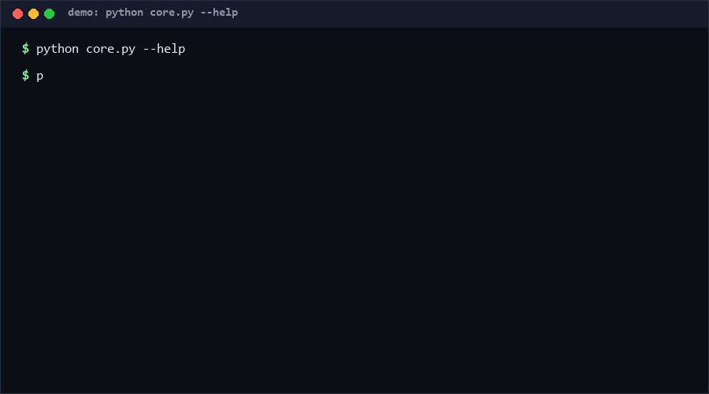

# lockfile-audit-diff

Audit the delta between two dependency lockfiles: pip-freeze TXT or a
canonical JSON package list in, an added/removed/changed diff out, with new
dependencies risk-annotated for unknown license, pre-1.0 versions,
typosquat-proximate names, unparseable versions, and deep transitive
placement. Pure standard library, offline, deterministic output.
Confidence: high for diff mechanics; heuristics are advisory signals.

as of 2026-10-11

<p align="center"></p>

## Problem

A dependency bump PR shows "add left-pad 1.3.0" and every reviewer shrugs.
The dangerous questions — does it declare a license, is it a 0.x toy, is
`reqeusts` one typo away from `requests`, is it buried four levels deep —
are never asked because answering them by hand across 300 packages is
unrealistic. Full supply-chain scanners are heavy; a review-sized diff with
risk labels is the missing middle layer.

## How it works

- **Parsers**: TXT (`name==version`, `#` comments) and JSON
  `{"packages": [{name, version, license, dependencies}]}` (a bare list is
  also accepted). Format sniffing by first character; malformed JSON fails
  loudly with exit 2.
- **Diff**: added / removed / changed (version) / unchanged counts.
- **Depths**: BFS from roots (packages nobody depends on) gives each package
  a transitive depth; cycle members get depth -1 instead of hanging.
- **Risk annotations** (added packages only):
  `license-unknown`, `pre-1.0` (major version 0), `typosquat-proximity`
  (Levenshtein ≤ 2 against an existing dependency name),
  `unparseable-version`, `deep-transitive` (depth ≥ 4).
- Exit codes: `0` clean, `1` risk findings, `2` unreadable input.

## Quickstart

```bash
python core.py old-lockfile new-lockfile             # JSON report (~1 s)
python core.py old.txt new.txt --format text         # human-readable
python self_test.py                                  # ~55 test cases (~4 s)
```

## Why not X

| Alternative | Stars (as of 2026-10-11) | How this differs |
| --- | --- | --- |
| [BCS911/mcp-lockfile-audit](https://github.com/BCS911/mcp-lockfile-audit) | 0 | Captures and compares MCP *tool catalogs* for drift; this repo audits dependency lockfiles — packages and versions, not tool registries. |
| [Behnam1369/lockfile_audit](https://github.com/Behnam1369/lockfile_audit) | 0 | Audit repo without published diff semantics; this repo defines a concrete risk model (5 labels) with deterministic, test-covered output. |
| [ak40u/nextjs-railway-starter](https://github.com/ak40u/nextjs-railway-starter) | 0 | A starter app that mentions a one-off clean lockfile audit; this repo is the reusable audit step itself, runnable on any pair of lockfiles. |

Anchors found via search as of 2026-10-11; descriptions paraphrased.

## Minimal Fallback

No tooling budget? `diff <(sort old.txt) <(sort new.txt)` gives you the
added/removed lists. You lose version-change detection, dependency depth,
and every risk label — but it catches "what is new" in one line.

## Design Trade-offs

- Name-proximity typosquat heuristic over a registry lookup: works offline
  and deterministically, but cannot see newly-registered lookalikes it has
  no baseline for — edit distance ≤ 2 is deliberately conservative.
- Depth via BFS shortest-path over declared dependencies: cheap and
  cycle-safe, but reports minimum depth, not reachability variants.
- Only two lockfile formats: JSON package lists and TXT pins; npm
  `package-lock.json` with its nested `packages` map is not parsed (yet).

## Limits & Second-order Effects

- Risk labels are heuristics: a legit 0.x library is not malicious, and a
  licensed 1.x typosquat with edit distance 3 slips through.
- Removal is never flagged as risk, but removing a transitive dep can break
  depth assumptions of the remaining graph.
- Second-order effect: teams may start avoiding 0.x upgrades to keep reports
  green, even when the 0.x is the right choice.

## FAQ

**Is this a security scanner?**
No. It produces advisory labels for code review; it does not fetch
advisory databases or verify signatures.

**When NOT to use this?**
When you need CVE matching, license-compatibility verdicts, or SBOM
compliance attestation. This tool structures the review conversation; it
does not close it.

**Why JSON and TXT only?**
They cover pip-style pinning and any store that can export a package list;
adding formats is a parser away.

## Core Assumptions

- [A1] Both lockfiles describe the same ecosystem, so name comparison is
  meaningful.
- [A2] The `license` field, when present, is truthful; this tool does not
  validate license text.
- [A3] Dependency graphs are small enough for in-memory BFS (thousands of
  nodes, not millions).

Confidence: diff/depth logic high; typosquat heuristic medium. All claims
as of 2026-10-11.

---

Part of the [zhengming-toolbox](https://github.com/chenhz01/zhengming-toolbox) — 55 purpose-built AI-engineering tools across neglected niches.

Related tools: [money-precision-check](https://github.com/chenhz01/money-precision-check) · [unit-confusion-check](https://github.com/chenhz01/unit-confusion-check) · [log-redaction-spec](https://github.com/chenhz01/log-redaction-spec)
